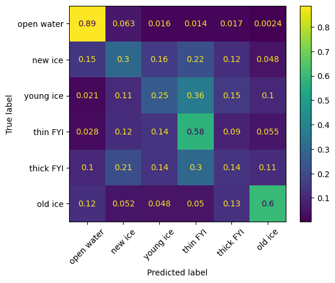
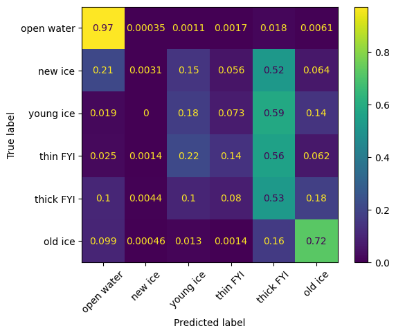

# Sea Ice Type Classification from C-band SAR: SVM + GLCM vs. U-Net

Classifying six sea ice types from Sentinel-1 C-band SAR imagery, comparing a classic
texture-based approach (SVM with GLCM features) against a deep learning model (U-Net).

## Motivation
Identifying new and young (thin) ice matters for navigation safety and climate monitoring,
but these ice types are hard to separate in C-band SAR. This project tests how a classic
texture-based classifier and a deep learning model handle that problem.

## Data
- **Dataset:** [sci-sea-ice-charting-sar](https://huggingface.co/datasets/Emulated-Inc/sci-sea-ice-charting-sar) (Hugging Face)
- 347 Sentinel-1 scenes (2018), Canadian Ice Service ice charts
- Inputs: HH and HV backscatter (dB), incidence angle; 400 m pixel spacing
- Labels: stage of development (SOD), 6 classes: open water, new ice, young ice,
  thin first-year ice (FYI), thick FYI, old ice
- Strong class imbalance: open water ≈ 70% of labelled pixels; new, young and thin ice ≈ 2–3.5% each
- Split **by scene** (278 training / 69 validation) to avoid leakage between nearby patches

## Methods
**1. SVM + GLCM (classic baseline)**
- 6,000 balanced training pixels (1,000 per class)
- Features: HH, HV + GLCM texture (contrast, homogeneity, correlation, energy) from an 11×11 window, for both HH and HV
- Two models compared: backscatter only vs. backscatter + texture

**2. U-Net (deep learning)**
- 128×128 patches (8,013 training / 1,945 validation), inputs HH, HV, incidence angle
- Class-weighted loss (inverse square root of class frequency); no-data pixels ignored
- Trained on a T4 GPU with early stopping

Both models are evaluated on the **same 18,255 validation pixels**.

## Results

| Ice type | SVM (backscatter only) | SVM + GLCM | U-Net |
|---|---:|---:|---:|
| Open water | 0.70 | 0.91 | **0.96** |
| New ice | 0.08 | **0.17** | 0.01 |
| Young ice | **0.28** | 0.25 | 0.21 |
| Thin FYI | 0.26 | **0.32** | 0.18 |
| Thick FYI | 0.10 | 0.18 | **0.44** |
| Old ice | 0.57 | 0.66 | **0.70** |
| **Accuracy** | 0.48 | 0.69 | **0.78** |
| **Macro F1** | 0.33 | **0.42** | **0.42** |

*Per-class values are F1 scores.*

## Key findings
- **Texture matters:** adding GLCM features raised SVM accuracy from 0.48 to 0.69.
- **The U-Net is better on common classes** (open water, thick FYI, old ice) and reaches the highest accuracy (0.78).
- **The U-Net mostly predicts thin and young ice as thick FYI**, while the balanced-trained SVM performs better on new, young and thin ice.
- **Neither model separates early-stage ice well**, consistent with earlier findings that
  C-band SAR has difficulty distinguishing young ice types (Mahmud et al., 2022).

## Limitations
- 400 m pixels limit fine texture detail
- Ice chart labels are polygon-based, so pixel labels are approximate
- A single train/validation split and a single training run
- No incidence-angle normalization of backscatter

## Next steps
- Stronger class weighting or focal loss, plus data augmentation, for the rare ice types
- Incidence-angle normalization
- Combining C-band with L-band SAR (e.g. ALOS-2, NISAR), which has been shown to help with young ice

## Files
- `sar_ice_tracking.ipynb`: full pipeline (data loading, SVM + GLCM, U-Net, evaluation)
- `unet.keras`: trained U-Net model
- `figures/`: confusion matrices

## References
- Haralick, R. M., Shanmugam, K., & Dinstein, I. (1973). Textural features for image classification. *IEEE Transactions on Systems, Man, and Cybernetics*, SMC-3(6), 610–621.
- Cortes, C., & Vapnik, V. (1995). Support-vector networks. *Machine Learning*, 20(3), 273–297.
- Ronneberger, O., Fischer, P., & Brox, T. (2015). U-Net: Convolutional networks for biomedical image segmentation. *MICCAI 2015*.
- Mahmud, M. S., Nandan, V., Singha, S., Howell, S. E. L., Geldsetzer, T., Yackel, J., & Montpetit, B. (2022). C- and L-band SAR signatures of Arctic sea ice during freeze-up. *Remote Sensing of Environment*.
- Dataset: Emulated-Inc, *sci-sea-ice-charting-sar*, Hugging Face. Based on Sentinel-1 data (ESA Copernicus) and Canadian Ice Service ice charts.
